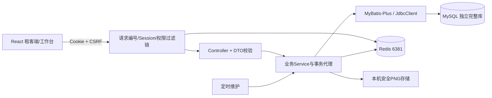

# 架构与边界

## 一次预约

1. 前端仅在本次预约意图创建时生成 UUID，重试保留；Cookie 标识登录会话。
2. Spring Session 从 Redis 恢复会话，身份过滤器根据数据库 enabled 状态建立当前请求的角色。
3. CSRF 与 DTO 验证后，Controller 根据来源 IP 限流；用户 ID 取自服务端身份。
4. 幂等入口规范化 UUID，将用户 ID 和规范化请求内容一起计算 SHA-256。
5. 独立事务先插入 `appointment_request`，再按 `room → active lease → slot` 加锁，检查时间和容量，插入预约并绑定编号。
6. 唯一冲突退出写事务并回滚后，在外层查询已完成记录；同内容重放，不同内容409。不要在同一个事务里吞掉唯一异常。
7. 审核使用状态条件更新；用户取消锁定本人预约。两者仅允许一次状态转换和名额释放。

## 事务与并发

- 数据库主键、唯一约束、外键、CHECK 是应用校验之外的最后一道约束。
- 外层审核事务包含状态更新、拒绝释放名额、审核记录；记录失败会一起回滚。
- 租约房间锁串行化同一房间的签约，使用半开租期区间，DRAFT 和 ACTIVE 都占用签约范围。
- 租约写流程显式使用当前读/行锁；幂等分支返回最新状态，见 LEASING.md 的隔离级别说明。
- 支付按 lease → bill 加锁，唯一账期防重复开账，PAID 重放不再次记账；无真实扣款。
- 只读事务不代替权限校验，也不保证自动变快。Redis 操作不参加 MySQL 本地事务。

## 三种编号

|编号|生命周期|用途|
|---|---|---|
|请求编号 X-Request-Id|每个HTTP请求新建|关联日志和错误响应|
|Session ID|一次登录会话|从Redis找到登录身份，登录成功更换|
|Idempotency-Key|一次预约意图及其重试|防重复创建预约|

MDC 仅自动覆盖当前线程；异步导出线程池通过 TaskDecorator 复制并清理上下文。Spring 的 Controller/Service 默认单例，当前请求数据放方法参数和局部变量。

## 安全与错误

租客只访问本人资源，管理员权限不等于租客身份。Session 中只存管理员或用户 ID，二者互斥；密码只保存 BCrypt Hash。CSRF 验证保持开启，浏览器不在 localStorage 中存令牌。未经验证的转发头不能当来源 IP。

MVC 内异常由 GlobalExceptionHandler 返回 ProblemDetail；Session 加载等在 MVC 之前的基础设施故障由外层过滤器返回503。内部异常和SQL细节不返回客户端，日志不记录密码、Cookie或联系人正文。

上传只接受有真实PNG/JPEG签名的图片，限制字节和像素数，重新编码为PNG，随机文件名。CSV 使用参数绑定和单元格公式转义；最多导出5000行，线程池和队列均有限。

## 运行与隔离

Flyway V1 建立完整模型。应用只能使用独立数据库账户；默认不指向旧库。Redis使用独立端口和命名空间，Cookie名称也与原项目不同。测试Profile禁止demo初始化和定时触发，单元测试不依赖现有服务。
