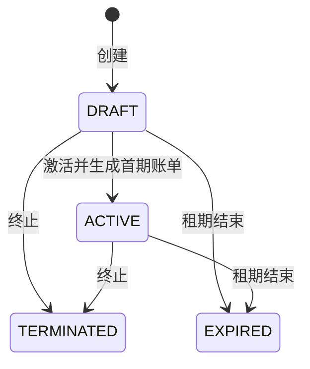
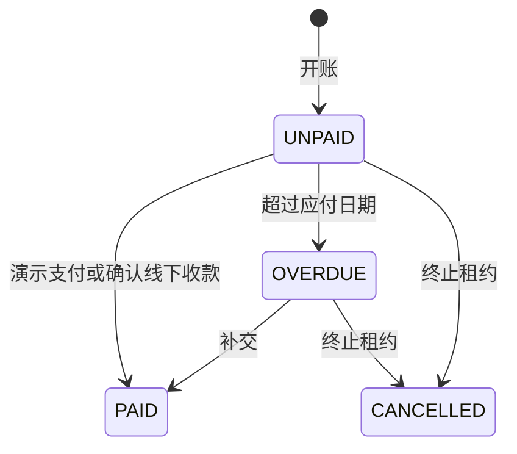

# 租约、账单和站内通知

本模块对应 `com.yuji.apartment.leasing`，供管理员工作台和租客中心使用。所有金额单位为人民币元，使用 `BigDecimal`。账单支付为演示账本或管理员登记线下收款，不连接支付网关，不真实扣款。

## 业务规则

- 租期采用 `[startDate, endDate)`：起租日期包含，退租日期不包含，允许下一份租约在同一天接续。
- 创建时从房间读取月租，客户端不能通过支付请求改变应收金额。
- 同一个房间的 `DRAFT`、`ACTIVE` 租约不能存在重叠租期。
- 新租约起租日期不能早于今天，日期按上海时区解释，数据库操作时间按 UTC 保存。
- 激活后生成首期账单：完整一个月的月租加押金。后续账单为完整月租，不做短租日租折算。
- 每期账单按最初的起租日计算周年日期，月末日期会自然收敛到对应月份最后一天，后续月份仍基于原起租日，避免日期漂移。
- 每个租约每个月份最多一张账单，由数据库 `UNIQUE(lease_id, period)` 和租约行锁共同保护。
- 终止会取消未支付账单；已经支付的历史记录保留，押金清退、退款需要联系管理员线下处理。自然到期则保留欠款，`EXPIRED` 租约中的未付账单仍可结清。

## 数据隔离与事务

个人接口的用户编号只读取服务端 Session 中的 `userId`，不接受请求参数中的用户编号。支付和标记消息已读会再次检查记录归属，其他用户的编号返回 404。

写入口显式采用 `READ_COMMITTED`，并用行锁保护业务状态；避免默认可重复读事务在等待锁之前建立的快照，使幂等支付的返回视图仍显示旧的 `UNPAID`。读接口继续使用只读事务。

创建和租约转换按“房间行 → 租约行 → 账单行”顺序加锁。支付只需要“租约行 → 账单行”，不会为了读取返回 DTO 再对关联房间加锁。首次租约查找只确定不会变更的房间编号；锁后校验账号、重叠租期和账单进度使用 `FOR SHARE` / `FOR UPDATE` 当前读。状态更新和站内通知写入在同一个事务中；通知失败会使对应业务回滚。重复激活和重复支付返回已存在的最新状态，不重复生成账单或通知。

管理员接口受 `/api/admin/**` 的角色规则保护，个人接口受 `/api/me/**` 的用户角色规则保护，所有写请求保留 CSRF 校验。

## API

| 接口 | 用途 |
| --- | --- |
| `GET/POST /api/admin/leases` | 分页查询、创建租约 |
| `POST /api/admin/leases/{id}/activate` | 激活租约 |
| `POST /api/admin/leases/{id}/terminate` | 终止租约 |
| `GET /api/me/leases` | 本人的租约 |
| `GET /api/admin/bills` | 管理员分页查账单 |
| `POST /api/admin/bills/{id}/mark-paid` | 记录线下收款 |
| `GET /api/me/bills` | 本人的账单 |
| `POST /api/me/bills/{id}/pay` | 演示支付 |
| `GET /api/me/notifications` | 最新 100 条个人通知 |
| `PATCH /api/me/notifications/{id}/read` | 标记本人消息已读 |
| `GET /api/admin/dashboard` | 运营统计，最近预约手机号脱敏 |
| `POST /api/admin/maintenance/run` | 手动运行一批维护任务 |

分页参数为 `page`、`pageSize`，默认 1 和 10，最大每页 100 条。租约支持 `status`、`roomId`，账单支持 `status`、`leaseId`（个人账单不接受其他人的用户编号）。

## 定时维护

`LeaseMaintenanceJob` 默认上海时间每天 00:10 执行。`app.jobs.enabled=false` 关闭定时触发，管理员仍可手动运行。`app.maintenance.batch-size` 默认 200，上限 500。

任务每轮只取有限数量的待处理租约，按照最近维护时间轮转；每条租约由独立事务处理。它会处理到期状态、按起租日补齐应生成的账单，并将有限数量的已逾期未付账单标记为 `OVERDUE`。重复执行依靠状态条件、行锁和唯一账期实现幂等。多实例中本地锁只避免本进程重入，正确性最终由数据库约束保证。

每个租约每轮最多补齐 12 期账单，从已有账单的最大应付日期推导进度，不从当前月份直接跳过历史。离线时间较长时可以重复维护渐进补齐；已经到期但还没有补齐历史账单的租约仍会被选中，完成后自动退出候选。未激活就到期的草稿不产生租金义务。大规模生产场景可进一步增加专用调度游标及批次监控。

## 学习入口

1. `LeasingDtos`：输入校验、分页和返回 DTO。
2. `LeasingRepository`：参数化 SQL、JOIN、聚合、行锁、账期唯一性。
3. `LeasingService`：事务边界、状态机、所有权检查、金额计算、幂等支付。
4. `LeaseMaintenanceJob`：定时调度、批处理边界、重入保护、按业务键幂等。
5. `LeasingServiceTest` 和 `TenantLeasingControllerTest`：状态转换与越权边界测试。
